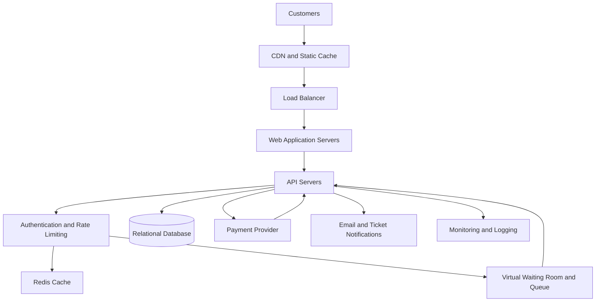

# TicketHub: Event Ticketing System Design

## 1. Requirements

### 1.1 Functional Requirements

TicketHub is a website where users can browse concerts and events, select seats, pay for tickets and view their purchases.

The system must allow users to:

1. Register, log in and manage their accounts.
2. Browse events and search by name, date or location.
3. View event details, ticket prices and available seats.
4. Temporarily hold available seats while completing a purchase.
5. Pay for held seats using a supported payment method.
6. Receive confirmation after a successful payment.
7. View their purchased tickets and order history.
8. Cancel orders or request refunds where the event's policy allows.
9. Allow administrators to create events, manage seats and monitor sales.

### 1.2 Non-Functional Requirements

**Performance:** Event pages should normally load within 2 seconds under expected traffic. Seat availability and purchase requests should respond quickly, although response times may increase during a major sale.

**Correctness:** A seat must never be sold to two customers for the same event. The database must be the final authority on seat availability.

**Fairness:** Customers should enter a virtual queue during highly popular sales. Requests should be processed in queue order as far as practical, with reasonable protection against automated abuse. A customer must not receive an unfair advantage simply by sending repeated requests.

**Availability:** The website should remain usable if some application servers fail. During extreme demand, browsing may be prioritised while non-essential features are temporarily limited.

**Scalability:** The system should support 2 million registered users and scale horizontally when traffic increases.

**Security:** Passwords must be securely hashed, payment details handled through a trusted payment provider, and API endpoints protected by authentication, authorisation and rate limits.

**Reliability:** Orders and payments must be recorded consistently. Retried requests should not create duplicate orders or charge customers more than once.

**Maintainability:** The system should use clear API boundaries, documented endpoints, database migrations and monitoring.

## 2. Traffic Estimates

### 2.1 Normal-Day Traffic

Given:

- Registered users: 2,000,000
- Daily visitors: 50,000
- Pages viewed per visitor: 10
- Tickets sold per day: 5,000

Daily page views:

50,000 × 10 = 500,000 page views per day.

Average page requests per second:

500,000 ÷ 86,400 = approximately 5.8 requests per second.

Average ticket sales per second:

5,000 ÷ 86,400 = approximately 0.058 tickets per second.

These are daily averages. Actual traffic will vary depending on events, advertising and the time of day.

### 2.2 Popular Concert Sale

Given:

- 200,000 people try to buy tickets.
- Only 20,000 seats are available.
- The sale takes place within the first 10 minutes.

Average purchase attempts per second:

200,000 ÷ 600 = approximately 333 attempts per second.

Average available seats sold per second if all seats sell within 10 minutes:

20,000 ÷ 600 = approximately 33 successful seat sales per second.

Only 10% of the people attempting to buy can obtain a seat. The other customers must see a clear sold-out message or an appropriate queue status.

For capacity planning, assume each person generates three initial requests: loading event details, viewing seats and attempting to obtain a hold.

Total initial requests:

200,000 × 3 = 600,000 requests.

Average initial request rate during the 10-minute sale:

600,000 ÷ 600 = 1,000 requests per second.

This is an estimate, not a measured peak. Real traffic may arrive in sudden bursts, so the system must be tested above the estimated average.

### 2.3 Comparison

| Metric | Normal Day | Popular Sale |
|---|---:|---:|
| Visitors or purchase attempts | 50,000 per day | 200,000 in 10 minutes |
| Page or initial requests | 500,000 per day | 600,000 initial requests |
| Average request rate | 5.8 requests/second | 1,000 requests/second |
| Ticket sales | 5,000 per day | Up to 20,000 in 10 minutes |
| Average successful sales rate | 0.058 per second | 33.3 per second |

The estimated initial request rate during the popular sale is about 173 times the normal daily average page request rate.

The system should therefore use a queue, caching, load balancing and carefully controlled database writes. The estimates are averages and do not guarantee that the highest instantaneous load will be only 1,000 requests per second.

## 3. API Design

The API uses REST endpoints and JSON responses. HTTPS is required. Authenticated endpoints require a valid access token.

| Method | Endpoint | Purpose |
|---|---|---|
| GET | /api/events | Browse and search events |
| GET | /api/events/{eventId} | View event details |
| GET | /api/events/{eventId}/seats | View seat availability |
| POST | /api/events/{eventId}/holds | Temporarily hold selected seats |
| GET | /api/holds/{holdId} | Check hold status and expiry |
| POST | /api/orders | Create an order from a valid hold |
| POST | /api/orders/{orderId}/payment | Start or confirm payment through the payment provider |
| GET | /api/tickets/me | View the logged-in user's tickets |
| GET | /api/orders/{orderId} | View order status and details |

### Example: Browse Events

GET /api/events?date=2026-12-20&location=Nairobi

The response contains matching events, dates, venues and starting prices.

### Example: View Seats

GET /api/events/123/seats

The response lists seat identifiers, prices and statuses such as available, held or sold. Seat availability may change immediately after the response, so the display is not a guarantee that a seat can still be purchased.

### Example: Hold Seats

POST /api/events/123/holds

Request body:

    {
      "seat_ids": [501, 502],
      "idempotency_key": "unique-request-abc123"
    }

The server verifies availability and creates a temporary hold, for example for five minutes. If the seats are unavailable, it returns a conflict response instead of creating the hold.

### Example: Create an Order

POST /api/orders

Request body:

    {
      "hold_id": "hold_789",
      "idempotency_key": "order-request-abc123"
    }

The server checks that the hold belongs to the user and has not expired. It then creates a pending order.

### Example: Pay for an Order

POST /api/orders/order_456/payment

The server initiates payment through a payment provider. The order is marked paid only after a verified payment confirmation. Payment webhooks must be authenticated and processed idempotently.

### Example: View My Tickets

GET /api/tickets/me

The server returns only tickets belonging to the authenticated user.

### Important API Rules

- Use HTTP 409 Conflict when a requested seat is no longer available.
- Use HTTP 401 for unauthenticated requests and HTTP 403 for unauthorised actions.
- Apply rate limits to sensitive endpoints.
- Use idempotency keys to prevent repeated requests from creating duplicate orders or payments.
- Never trust the price submitted by a client; calculate the final price on the server.
- Do not expose another user's orders or personal information.

## 4. Data Model

The database uses relational tables with primary keys, foreign keys, unique constraints and transactions.

### 4.1 Users

| Column | Type | Description |
|---|---|---|
| user_id | BIGINT, primary key | Unique user identifier |
| name | VARCHAR | User's name |
| email | VARCHAR, unique | Login email |
| password_hash | VARCHAR | Securely hashed password |
| created_at | TIMESTAMP | Account creation time |

### 4.2 Events

| Column | Type | Description |
|---|---|---|
| event_id | BIGINT, primary key | Unique event identifier |
| title | VARCHAR | Event name |
| venue | VARCHAR | Event location |
| starts_at | TIMESTAMP | Event start time |
| status | VARCHAR | Draft, published or cancelled |

### 4.3 Seats

Each seat belongs to one event. A separate seat record is created for every seat available at an event.

| Column | Type | Description |
|---|---|---|
| seat_id | BIGINT, primary key | Unique seat identifier |
| event_id | BIGINT, foreign key | References Events |
| seat_label | VARCHAR | Seat number or label |
| price | DECIMAL | Ticket price |
| status | VARCHAR | Available, held or sold |
| hold_id | UUID, nullable | Current hold identifier |
| hold_expires_at | TIMESTAMP, nullable | Hold expiry time |

A unique constraint on `(event_id, seat_label)` prevents the same physical seat from being entered twice for one event.

### 4.4 Orders

| Column | Type | Description |
|---|---|---|
| order_id | BIGINT, primary key | Unique order identifier |
| user_id | BIGINT, foreign key | References Users |
| status | VARCHAR | Pending, paid, cancelled or refunded |
| total_amount | DECIMAL | Total amount charged |
| idempotency_key | VARCHAR | Prevents duplicate order creation |
| created_at | TIMESTAMP | Order creation time |

The combination of `user_id` and `idempotency_key` should be unique.

### 4.5 Order_Items

This table connects orders to the seats purchased.

| Column | Type | Description |
|---|---|---|
| order_item_id | BIGINT, primary key | Unique order line |
| order_id | BIGINT, foreign key | References Orders |
| seat_id | BIGINT, foreign key | References Seats |
| price_at_purchase | DECIMAL | Price recorded for the order |

A unique constraint on `seat_id` prevents a seat from appearing in more than one active or completed purchase record. If refunds or cancellations are supported, the design must retain the historical record while controlling when a seat can be sold again. A partial unique index or a separate seat-allocation table can enforce uniqueness for active and completed allocations.

### 4.6 Relationships

- One user can place many orders.
- One event can contain many seats.
- One order can contain many order items.
- Each order item references one seat.
- Each seat belongs to one event.
- A seat may have temporary holds over time, but it must have at most one valid active hold at any moment.

The five tables above form the main data model. A production implementation could add a separate `Seat_Holds` table and a `Payments` table to retain payment attempts and hold history.

## 5. Preventing Double-Booking

Preventing two customers from buying the same seat is the most important correctness requirement.

The application must not simply read a seat as available and then update it later without protection. Two requests could read the same available seat before either request changes it.

TicketHub prevents this using a database transaction and a conditional update.

### Seat-Hold Process

1. The customer selects one or more seats.
2. The server starts a database transaction.
3. It locks the requested seat rows in a consistent order, or performs a conditional update that succeeds only if each seat is available or its previous hold has expired.
4. It creates a hold with an expiry time, such as five minutes.
5. It commits the transaction only if all requested seats were successfully held. Otherwise, it rolls back the transaction.
6. Other customers cannot obtain the same seats while the valid hold exists.

A simplified SQL operation for one seat is:

    UPDATE seats
    SET status = 'held',
        hold_id = :hold_id,
        hold_expires_at = :expiry
    WHERE seat_id = :seat_id
      AND (
        status = 'available'
        OR (
          status = 'held'
          AND hold_expires_at < CURRENT_TIMESTAMP
        )
      );

The application must check that exactly one row was updated. If zero rows were updated, the seat is no longer available to that request. For multiple seats, all updates must be in the same transaction, and the transaction must roll back if any seat fails.

### Payment and Confirmation

After a successful hold, the customer proceeds to payment. The server verifies that the hold is still valid and belongs to the customer.

A verified payment confirmation is processed idempotently. The system then changes the order to paid and the seats to sold in a database transaction. If the payment provider is temporarily unavailable, the order remains pending rather than being incorrectly marked paid.

The system must also handle payment timeouts and late confirmations carefully. It should not release a seat while a payment is still being reconciled. If a payment succeeds after the hold expires, the system needs a defined recovery process, such as restoring the allocation if still available or issuing a refund.

### Why This Works

Database transactions ensure that a group of related changes succeeds or fails together. Row locks or conditional updates prevent concurrent requests from claiming the same available seat. Unique constraints provide an additional safety check.

The application server alone cannot guarantee this because multiple servers may process requests at the same time. The database must enforce the final allocation rules.

## 6. System Architecture

### 6.1 Architecture Diagram

### 6.2 Component Explanations

**Customers:** Use browsers or mobile devices to search for events and buy tickets.

**CDN and Static Cache:** Serves images, stylesheets and other static files from nearby locations. Public event information can be cached to reduce requests reaching the application.

**Load Balancer:** Distributes requests across multiple application servers and stops traffic from depending on a single server.

**Web Application Servers:** Deliver the user interface and handle browser interactions. They can be scaled horizontally.

**API Servers:** Validate requests, check permissions, calculate prices and coordinate holds, orders and payments. They should remain stateless where possible so more instances can be added.

**Authentication and Rate Limiting:** Verifies users and restricts excessive requests. A virtual waiting room can issue queue tokens and control how many customers enter the purchase process at once.

**Redis Cache:** Stores frequently requested, non-authoritative data such as event details and queue information. The database remains the source of truth for seat ownership.

**Virtual Waiting Room and Queue:** Manages demand during popular sales and releases customers to the purchase service at a controlled rate. The queue should provide clear status updates and prevent repeated requests from bypassing normal access rules.

**Relational Database:** Stores users, events, seats, holds and orders. Transactions, locks and constraints protect the correctness of ticket allocation.

**Payment Provider:** Processes payments without requiring TicketHub to store raw card details. Verified callbacks update order status.

**Notifications:** Sends confirmation messages and ticket information after successful purchases. Notifications can be queued and retried without blocking seat allocation.

**Monitoring and Logging:** Tracks request rates, latency, failed holds, payment errors, queue length and database performance. Alerts help operators respond before the system becomes unavailable.

### 6.3 Surviving the Big Sale

The virtual queue limits the rate at which purchase requests reach the database. The CDN and cache serve public event pages without requiring every request to access the database. Load balancing distributes requests across multiple application servers.

The database should be sized and load-tested for the expected write rate, with connection pooling and appropriate indexes. Seat allocation should use short transactions because long transactions can block other buyers. Database replicas may serve suitable read queries, but all seat claims must be checked against the authoritative write database.

The system should also use autoscaling where practical, payment retries with idempotency, and alerts for rising latency or database contention. If demand exceeds capacity, customers should receive a queue position or a clear retry message instead of causing uncontrolled database overload.

## 7. Trade-Offs

### Trade-Off 1: Fairness Versus Speed

A virtual waiting room makes the sale more orderly and protects the database from a sudden flood of requests. However, customers may wait even when some seats are available. A simple direct-access system is faster for individual users under low traffic but can become unfair and unstable during a major sale.

**Decision:** Use a virtual queue for popular sales and direct access during normal traffic.

### Trade-Off 2: Seat Holds Versus Lost Sales

Temporary holds give customers time to pay and reduce competition over the same seats. However, customers may hold seats and abandon their purchases, making those seats unavailable temporarily.

**Decision:** Use short, clearly communicated hold periods and automatically expire abandoned holds. The expiry process must be coordinated with payment status so that seats are not released during an unresolved payment.

### Trade-Off 3: Strong Consistency Versus Read Performance

Checking all seat availability against the main database keeps the information authoritative, but heavy read traffic can increase database load. Caching improves speed but may show stale availability.

**Decision:** Cache event descriptions and other public information, but validate every seat hold against the main database. A displayed seat is not guaranteed until the hold succeeds.

## 8. Conclusion

TicketHub must support ordinary browsing while remaining correct and usable during a popular ticket sale. Traffic estimates help determine capacity, while caching, load balancing and a virtual queue control demand. Most importantly, database transactions, conditional updates and unique constraints prevent double-booking. This design balances performance, fairness, security and correctness while leaving room to scale as the platform grows.
