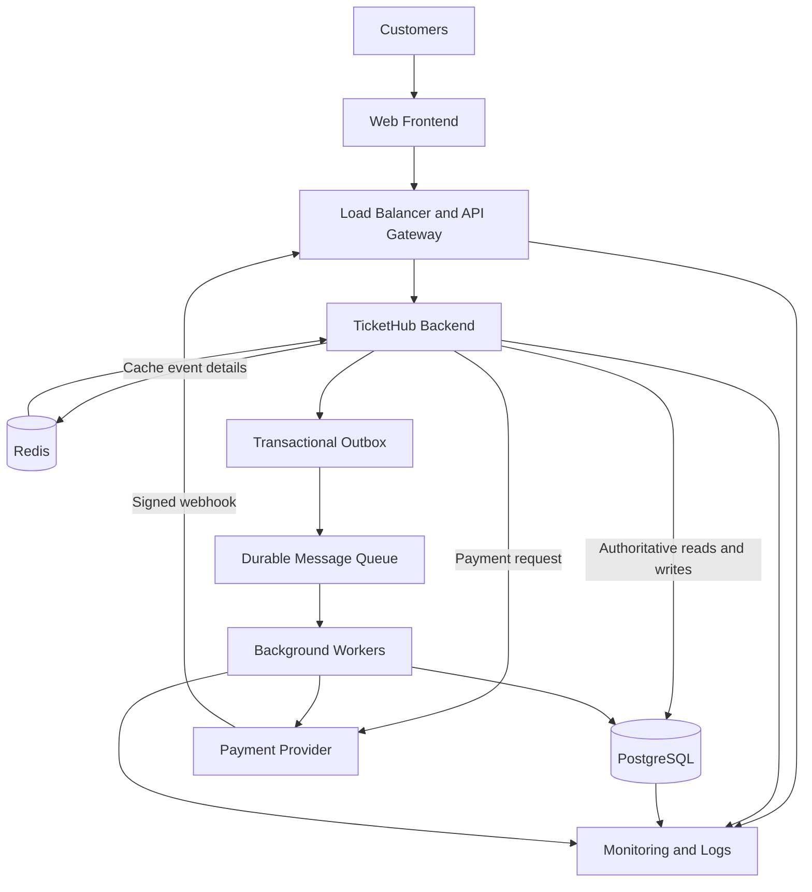

# TicketHub: Event Ticketing System Design

## 1. Introduction

TicketHub is an online event ticketing system that allows customers to browse events, view seat availability, reserve seats temporarily, and purchase tickets. It must support normal daily traffic as well as sudden demand when a popular event goes on sale.

The main challenge is ensuring that the same seat is never sold to two customers. During a busy sale, many customers may attempt to reserve the same seat almost simultaneously. TicketHub therefore needs a reliable database design, safe transaction handling, and an architecture that can manage traffic spikes without overwhelming the database.

This document describes the system requirements, traffic estimates, REST API, relational database, double-booking prevention strategy, architecture, and major design trade-offs.

## 2. System Requirements

### 2.1 Functional Requirements

The system must allow customers to:

1. Register, sign in, and manage their accounts.
2. Browse published events and view event details, prices, dates, and venues.
3. View seat maps and current seat availability.
4. Temporarily hold an available seat for a limited period.
5. Create an order using their active seat holds.
6. Complete payment through an external payment provider.
7. View their orders and payment status.
8. Receive appropriate responses when seats are unavailable or payments fail.

The system must also:

- Release seats when holds expire or purchases fail.
- Prevent two customers from holding or purchasing the same seat.
- Prevent repeated requests from creating duplicate orders or payments.
- Allow administrators to create events, configure seats, and open or close ticket sales.
- Record payment events and handle repeated provider notifications safely.

### 2.2 Non-Functional Requirements

| Requirement | Description |
|---|---|
| Performance | Event pages and seat information should respond quickly during normal traffic. |
| Scalability | The system should support everyday browsing and sudden sale peaks. |
| Security | Use HTTPS, secure password hashing, authentication, authorization, and input validation. |
| Reliability | Retries and duplicate payment notifications must not create conflicting records. |
| Consistency | PostgreSQL must remain the authority for seat allocation and order state. |
| Availability | Browsing should remain useful during demand spikes, while checkout can be rate-limited to protect critical operations. |
| Maintainability | Event, seat, order, and payment responsibilities should be organized into clear modules. |
| Data protection | Do not store raw payment card details. Verify payment-provider signatures and protect sensitive information. |

## 3. Traffic and Capacity Estimates

The planning scenario provides the following figures:

- Registered users: 2,000,000.
- Daily visitors: 50,000.
- Page views per visitor: 10.
- Tickets sold per day: 5,000.
- Customers attempting to buy during a popular sale: 200,000.
- Seats available during that sale: 20,000.
- Duration of the initial sale rush: 10 minutes.

### 3.1 Normal Daily Traffic

Daily page views:

\[
50,000 \times 10 = 500,000
\]

Average page views per second:

\[
\frac{500,000}{86,400} \approx 5.79
\]

The system therefore averages approximately 5.79 page views per second over a full day.

The daily average number of tickets sold per second is:

\[
\frac{5,000}{86,400} \approx 0.058
\]

Ticket purchases are not evenly distributed throughout the day, so this figure does not represent the rate during a popular sale.

### 3.2 Popular-Sale Traffic

Assuming each of the 200,000 customers makes one initial request during the first 10 minutes:

\[
\frac{200,000}{10 \times 60} \approx 333.33
\]

This gives approximately 333 initial sale attempts per second.

This is an estimate, not the total API request rate. Customers may make additional requests to view seats, place holds, create orders, retry failed requests, and complete payments. Traffic may also arrive in short bursts that exceed the average.

The 20,000 available seats are fewer than the 200,000 potential buyers. The system must therefore handle many unsuccessful attempts while ensuring that each seat has only one valid allocation.

These calculations help with capacity planning, but they do not prove that a particular server configuration can handle the workload. Load testing and monitoring would be required to establish actual capacity.

## 4. REST API Design

TicketHub uses REST endpoints over HTTPS and exchanges JSON data.

Public event browsing can be unauthenticated. Seat holds, order creation, and order retrieval require authentication and authorization. Administrative operations require an administrator role. Payment webhooks are authenticated using the payment provider's signature rather than a customer's session.

| Method | Endpoint | Purpose | Important validation |
|---|---|---|---|
| GET | `/api/events` | Browse published events | Supports pagination and returns published events only. |
| GET | `/api/events/{event_id}` | View event details | Returns HTTP 404 if the event does not exist or is not published. |
| GET | `/api/events/{event_id}/seats` | View seat information | Displays availability, which may change before a hold is requested. |
| POST | `/api/seats/{seat_id}/holds` | Temporarily reserve a seat | Requires authentication and an idempotency key. Returns HTTP 409 if the seat cannot be held. |
| POST | `/api/orders` | Create an order from active holds | Validates ownership, hold expiry, seat state, and the idempotency key. |
| GET | `/api/orders/{order_id}` | Retrieve order and payment status | The customer must own the order or have administrative permission. |
| POST | `/api/payments/webhook` | Receive payment-provider notifications | Verifies the provider signature and deduplicates provider event IDs. |
| POST | `/api/admin/events` | Create an event | Requires administrator authorization and valid event details. |

### 4.1 Idempotency

Network failures can cause a client to retry a request even when the original request succeeded. Without protection, retries could create duplicate holds or orders.

For operations such as holding a seat and creating an order, the client supplies an `Idempotency-Key`. The server stores the key, the customer and operation, a request fingerprint, and the result.

If the same key is reused with the same request, the server returns the original result. If the key is reused with different request details, the server rejects it, for example with HTTP 409 Conflict.

Payment webhooks are also processed idempotently. Each provider event has a unique identifier stored in the database. Repeated delivery of the same event must not apply the payment transition twice.

## 5. Relational Database Design

PostgreSQL stores the authoritative records for users, events, seats, holds, orders, and payments. Foreign keys maintain valid relationships, while transactions and uniqueness constraints protect seat allocation.

The following schema describes the principal tables and constraints. In an implementation, UUID values are generated by the application or database, and queries use bound parameters.

### 5.1 Users

| Column | Type and constraints | Purpose |
|---|---|---|
| `user_id` | UUID PRIMARY KEY | Unique customer identifier. |
| `full_name` | VARCHAR(100) NOT NULL | Customer's name. |
| `email` | VARCHAR(255) NOT NULL UNIQUE | Unique account email. |
| `password_hash` | TEXT NOT NULL | Secure password hash, never the raw password. |
| `created_at` | TIMESTAMPTZ NOT NULL DEFAULT now() | Account creation time. |

### 5.2 Events

| Column | Type and constraints | Purpose |
|---|---|---|
| `event_id` | UUID PRIMARY KEY | Unique event identifier. |
| `event_name` | VARCHAR(200) NOT NULL | Event name. |
| `venue` | VARCHAR(200) NOT NULL | Event location. |
| `event_date` | TIMESTAMPTZ NOT NULL | Scheduled event date and time. |
| `status` | VARCHAR(20) NOT NULL CHECK (`status` IN ('draft', 'on_sale', 'closed')) | Controls event publication and sales. |
| `created_at` | TIMESTAMPTZ NOT NULL DEFAULT now() | Record creation time. |

### 5.3 Seats

| Column | Type and constraints | Purpose |
|---|---|---|
| `seat_id` | UUID PRIMARY KEY | Unique seat identifier. |
| `event_id` | UUID NOT NULL REFERENCES `events(event_id)` | Event containing the seat. |
| `seat_number` | VARCHAR(20) NOT NULL | Label such as A12. |
| `price` | NUMERIC(10,2) NOT NULL CHECK (`price` >= 0) | Ticket price. |
| `status` | VARCHAR(20) NOT NULL DEFAULT 'available' CHECK (`status` IN ('available', 'held', 'sold')) | Current seat state. |

A unique constraint on `(event_id, seat_number)` prevents duplicate seat labels within the same event.

The seat status is a convenient summary. The database's allocation records, constraints, and transactions provide the actual protection against duplicate claims.

### 5.4 Seat_Holds

| Column | Type and constraints | Purpose |
|---|---|---|
| `hold_id` | UUID PRIMARY KEY | Unique hold identifier. |
| `seat_id` | UUID NOT NULL REFERENCES `seats(seat_id)` | Seat being held. |
| `user_id` | UUID NOT NULL REFERENCES `users(user_id)` | Customer holding the seat. |
| `status` | VARCHAR(20) NOT NULL CHECK (`status` IN ('active', 'converted', 'released')) | Hold lifecycle state. |
| `created_at` | TIMESTAMPTZ NOT NULL DEFAULT now() | Time the hold was created. |
| `expires_at` | TIMESTAMPTZ NOT NULL | Time after which the hold may be released. |
| UNIQUE | `(hold_id, seat_id)` | Allows an order item to reference the matching hold and seat together. |

Historical holds are retained for auditing. Expired holds are explicitly changed to `released`; the system does not assume that a timestamp alone removes an allocation.

### 5.5 Orders

| Column | Type and constraints | Purpose |
|---|---|---|
| `order_id` | UUID PRIMARY KEY | Unique order identifier. |
| `user_id` | UUID NOT NULL REFERENCES `users(user_id)` | Customer placing the order. |
| `idempotency_key` | VARCHAR(100) NOT NULL | Identifies a retried order request. |
| `request_fingerprint` | TEXT NOT NULL | Identifies the request details associated with the key. |
| `status` | VARCHAR(20) NOT NULL CHECK (`status` IN ('pending_payment', 'paid', 'failed', 'cancelled', 'expired')) | Order lifecycle state. |
| `total_amount` | NUMERIC(10,2) NOT NULL CHECK (`total_amount` >= 0) | Total order amount. |
| `created_at` | TIMESTAMPTZ NOT NULL DEFAULT now() | Order creation time. |
| UNIQUE | `(user_id, idempotency_key)` | Prevents duplicate orders from the same customer's repeated request. |

The server compares the request fingerprint when an idempotency key is reused. A different request using the same key is rejected.

### 5.6 Order_Items

| Column | Type and constraints | Purpose |
|---|---|---|
| `order_item_id` | UUID PRIMARY KEY | Unique order-item identifier. |
| `order_id` | UUID NOT NULL REFERENCES `orders(order_id)` | Parent order. |
| `seat_id` | UUID NOT NULL REFERENCES `seats(seat_id)` | Seat being purchased. |
| `hold_id` | UUID NOT NULL | Hold authorizing the allocation. |
| `allocation_status` | VARCHAR(20) NOT NULL CHECK (`allocation_status` IN ('pending', 'sold', 'released')) | Allocation lifecycle state. |
| `price_at_purchase` | NUMERIC(10,2) NOT NULL CHECK (`price_at_purchase` >= 0) | Price captured when the order is created. |
| FOREIGN KEY | `(hold_id, seat_id)` REFERENCES `seat_holds(hold_id, seat_id)` | Ensures the referenced hold belongs to the same seat. |

A seat can have historical order items, but it must not have more than one pending or sold allocation at a time. The following partial unique index enforces this rule.

### 5.7 Payments

| Column | Type and constraints | Purpose |
|---|---|---|
| `payment_id` | UUID PRIMARY KEY | Unique payment identifier. |
| `order_id` | UUID NOT NULL UNIQUE REFERENCES `orders(order_id)` | Order being paid for. |
| `provider_reference` | VARCHAR(200) UNIQUE | Payment provider's transaction reference, when available. |
| `status` | VARCHAR(20) NOT NULL CHECK (`status` IN ('pending', 'succeeded', 'failed', 'cancelled')) | Payment lifecycle state. |
| `amount` | NUMERIC(10,2) NOT NULL CHECK (`amount` >= 0) | Amount expected or processed. |
| `created_at` | TIMESTAMPTZ NOT NULL DEFAULT now() | Payment creation time. |
| `updated_at` | TIMESTAMPTZ NOT NULL DEFAULT now() | Last payment-state update. |

This simplified design uses one payment record per order. The provider reference is unique when present. Raw card information is not stored.

### 5.8 Payment_Events

One payment can receive multiple different provider events, such as pending, succeeded, or failed notifications. Therefore, a single event-ID column in the payments table is not sufficient to deduplicate all webhook deliveries.

| Column | Type and constraints | Purpose |
|---|---|---|
| `payment_event_id` | UUID PRIMARY KEY | Internal event-record identifier. |
| `payment_id` | UUID NOT NULL REFERENCES `payments(payment_id)` | Associated payment. |
| `provider_event_id` | VARCHAR(200) NOT NULL UNIQUE | Unique identifier supplied by the payment provider. |
| `event_type` | VARCHAR(100) NOT NULL | Provider event type. |
| `processing_status` | VARCHAR(20) NOT NULL CHECK (`processing_status` IN ('received', 'processed', 'rejected')) | Tracks webhook processing. |
| `received_at` | TIMESTAMPTZ NOT NULL DEFAULT now() | Time the event was received. |

The unique provider event ID prevents the same webhook event from being inserted twice. Each event is validated and processed in a transaction. A repeated event returns an acknowledgement without repeating the state transition.

### 5.9 Allocation Constraints and Relationships

The following indexes protect the allocation rules:

```sql
CREATE UNIQUE INDEX one_active_hold_per_seat
    ON seat_holds (seat_id)
    WHERE status = 'active';

CREATE UNIQUE INDEX one_order_per_hold
    ON order_items (hold_id);

CREATE UNIQUE INDEX one_live_order_allocation_per_seat
    ON order_items (seat_id)
    WHERE allocation_status IN ('pending', 'sold');
```

Each index serves a different purpose:

- `one_active_hold_per_seat` allows at most one active hold record for a seat.
- `one_order_per_hold` prevents one hold from being attached to multiple order items.
- `one_live_order_allocation_per_seat` prevents a seat from being allocated to multiple pending or sold order items.

Expired holds must be explicitly changed from `active` to `released` under the seat lock. PostgreSQL partial indexes cannot safely use a moving `now()` condition to automatically remove expired records.

The main relationships are:

- One user can create many holds and orders.
- One event contains many seats.
- A seat can have historical holds but only one active hold.
- One order contains one or more order items.
- Each order item refers to the seat and hold authorizing its allocation.
- In this simplified design, one order has at most one payment record.
- One payment can have many payment-event records.

Failed or expired order allocations are changed to `released`, allowing the seat to be offered again. A sold ticket is not resalable in this design. Refunds and resale would require a separate, audited allocation transition.

## 6. Preventing Double-Booking

### 6.1 The Race Condition

Suppose customers A and B both request seat A12 at almost the same time.

If the application only checks whether the seat is available, both requests might read the same available state before either updates it. Both customers could then be told they have reserved the seat.

TicketHub prevents this by locking the seat row in PostgreSQL, handling expired holds while holding that lock, and creating a new hold within the same transaction.

### 6.2 Seat-Hold Transaction

The following SQL illustrates the critical seat-claim operation. The application supplies `:seat_id`, `:hold_id`, and `:user_id` as bound parameters.

```sql
BEGIN;

-- Lock the seat so competing claims must wait.
SELECT seat_id, status
FROM seats
WHERE seat_id = :seat_id
FOR UPDATE;

-- If the seat does not exist, roll back and return HTTP 404.

-- Release expired active holds while the seat is locked.
UPDATE seat_holds
SET status = 'released'
WHERE seat_id = :seat_id
  AND status = 'active'
  AND expires_at <= now();

-- Check the seat's current state and whether a live hold exists.
SELECT s.status,
       EXISTS (
           SELECT 1
           FROM seat_holds h
           WHERE h.seat_id = s.seat_id
             AND h.status = 'active'
             AND h.expires_at > now()
       ) AS has_live_hold
FROM seats s
WHERE s.seat_id = :seat_id;

-- Application logic:
-- If the seat is sold, or has a live hold, ROLLBACK
-- and return HTTP 409 Conflict.

-- Claim an available seat or a seat whose old hold expired.
UPDATE seats
SET status = 'held'
WHERE seat_id = :seat_id
  AND status IN ('available', 'held');

-- The application must verify that exactly one row changed.
-- If zero rows changed, ROLLBACK and return HTTP 409.

INSERT INTO seat_holds (
    hold_id,
    seat_id,
    user_id,
    status,
    expires_at
)
VALUES (
    :hold_id,
    :seat_id,
    :user_id,
    'active',
    now() + interval '10 minutes'
);

-- If the insert violates a constraint, roll back.
-- Commit only after the seat update and hold insert succeed.
COMMIT;
```

The application must implement the comments as real control flow. It must verify that the seat exists, check the result of the update, and roll back after any failed validation or database error. It must never commit a hold if the claim was unsuccessful.

The seat lock remains held until the transaction commits or rolls back. The `one_active_hold_per_seat` index is an additional safeguard if another code path does not follow the locking protocol.

Hold expiry workers follow the same locking order: lock the seat first, then release expired holds. They set the seat to `available` only when it is not sold and no live hold or pending allocation remains.

### 6.3 Two-Customer Example

1. Customer A and customer B request seat A12.
2. Customer A obtains the row lock.
3. Customer B waits for the lock.
4. Customer A checks availability, creates the hold, updates the seat, and commits.
5. Customer B obtains the lock after A's transaction finishes.
6. Customer B now sees A's active hold and rolls back with HTTP 409 Conflict.

If A's transaction fails before committing, PostgreSQL rolls back the changes. B can then acquire the lock and attempt the claim.

The two transactions cannot both commit active holds for the same seat: row locking serializes the claims, while the unique index provides additional protection.

### 6.4 Order and Payment Lifecycle

**Step 1: Create a pending order.**

The backend locks the customer's active hold and its seat. It checks that the hold belongs to the customer, has not expired, and is still valid. It then creates the order, order item, and pending payment record in a short transaction.

The `(user_id, idempotency_key)` constraint makes order retries safe. The server compares the stored request fingerprint and rejects a mismatched reuse of the key.

**Step 2: Request payment.**

The database transaction commits before the application calls the external payment provider. The order identifier is used as the merchant reference, and a stable provider idempotency key is used where supported.

A database transaction is never held open while waiting for an external payment response.

**Step 3: Confirm successful payment.**

The backend verifies the webhook signature and event contents. In a short transaction, it records the provider event using the unique event ID and locks the relevant payment, order, hold, and seat records in a consistent order.

It verifies that the order is still pending, the amount and currency match, and the hold is valid and belongs to the buyer. If all checks succeed, it marks the payment as succeeded, the order as paid, the hold as converted, the order item as sold, and the seat as sold. These local state changes commit together.

If the provider event ID already exists, the system does not repeat the state transition.

**Step 4: Handle failure or expiry.**

A verified failure marks the payment and order as failed and releases the order allocation and hold under the seat lock.

If no final payment result arrives before the payment window expires, a background worker locks the relevant records, expires the pending order, releases the allocation and hold, and makes the seat available only if no other valid allocation exists.

If a success notification arrives after the order has expired and the seat has been released or resold, the system must not sell the seat again. It records the late event and initiates a refund or reconciliation action.

**Step 5: Process secondary tasks.**

Email receipts, notifications, and analytics are processed asynchronously through a durable queue. A transactional outbox records follow-up events alongside the database changes so that a committed purchase does not lose its notification event.

Workers retry failed tasks safely. A reconciliation job compares unresolved local payments with provider state to recover from missing notifications.

The database transaction protects local state only; it does not include the external payment call.

## 7. System Architecture



### 7.1 Component Responsibilities

**Web frontend:** Displays event details, seat maps, holds, and checkout status.

**Load balancer and API gateway:** Distributes requests across healthy backend instances, routes API calls, and applies rate limits. Rate limiting can reduce bursts that would otherwise overwhelm the database.

**TicketHub backend:** Authenticates users, checks permissions, validates requests, and coordinates event, seat, order, and payment operations. It can begin as a modular application rather than several independent services.

**PostgreSQL:** Stores authoritative event, seat, hold, order, and payment data. Transactions, row locks, foreign keys, and unique constraints protect seat allocation and state transitions.

**Redis cache:** Reduces repeated reads of relatively stable event information. Cached seat availability may become stale, so actual seat claims always use PostgreSQL.

**Payment provider:** Processes payments outside the database transaction and sends signed notifications about payment outcomes.

**Transactional outbox and message queue:** Ensure that follow-up work can be processed asynchronously after a successful database state change.

**Background workers:** Handle hold expiry, notifications, payment reconciliation, and other tasks that do not need to run inside the customer's request.

**Monitoring and logs:** Track request rates, response latency, errors, database lock waits, queue backlog, webhook failures, and reconciliation results. Logs must not expose passwords, payment secrets, or raw card information.

### 7.2 Handling the Sale Peak

During a popular sale, the load balancer distributes requests across backend instances. Rate limits control bursts, and Redis reduces repeated reads of event details.

Background workers move notifications and other secondary work away from the checkout request path. The database remains responsible for deciding which customer obtains a seat.

If demand exceeds the safe processing capacity, the system can temporarily queue or reject excess hold requests rather than allowing uncontrolled database overload. Load testing is required to determine appropriate limits and capacity.

## 8. Architectural Trade-Offs

| Design choice | Benefits | Drawbacks | Decision for TicketHub |
|---|---|---|---|
| Row-level locking vs. optimistic concurrency | Row locks make competing seat claims easier to reason about and serialize access. | Popular seats can experience lock waits. | Prefer row locks for correctness, keep transactions short, and evaluate alternatives if measured contention becomes a problem. |
| Redis caching vs. fresh database reads | Caching reduces repeated reads and helps serve event pages during traffic spikes. | Cached information may be stale, and invalidation adds complexity. | Cache event details and display information, but use PostgreSQL for every actual allocation. |
| Synchronous vs. asynchronous processing | Synchronous database changes provide a clear result for checkout; queues move secondary tasks off the request path. | Queues require retries, monitoring, and duplicate-message handling. | Keep critical order and allocation changes transactional; process notifications asynchronously. |
| Modular monolith vs. independent services | A modular backend and shared database simplify transactions and deployment. | Individual modules cannot be scaled independently as easily. | Start with clear modules and split services only when operational evidence justifies the added complexity. |

## 9. Conclusion

TicketHub separates public event browsing from authenticated seat holds, order creation, and payment handling. The traffic estimates show that a popular sale creates a concentrated peak, so load balancing, rate limiting, caching, and background workers help protect the service.

PostgreSQL remains the authority for seat allocation. A transaction locks the seat, releases expired holds safely, checks for an existing allocation, and creates a new hold before committing. Unique indexes provide additional protection against duplicate active holds and live order allocations.

Orders and payment events use idempotency and short, atomic state transitions so that retries do not create duplicate purchases. Together, these design decisions provide a practical starting architecture that prioritizes seat correctness while preparing TicketHub to handle high demand.
