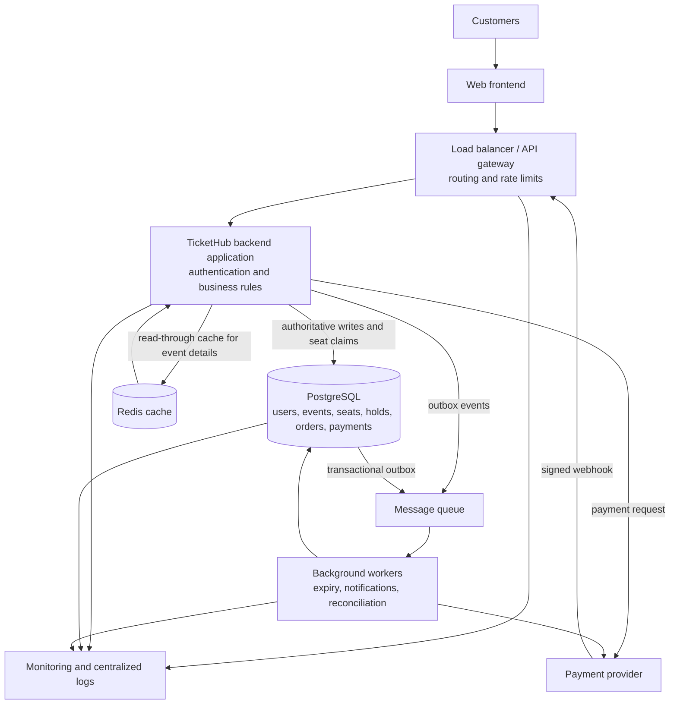

# TicketHub: Event Ticketing System Design

## 1. Introduction

TicketHub is an online event ticketing system. Customers use it to find events, see seat information, temporarily reserve seats, and pay for tickets. Popular sales can attract far more customers than there are seats, so the system must keep working under a traffic surge and must never sell one seat to two customers.

## 2. Requirements

### 2.1 Functional requirements

- Customers can register, sign in, and manage their accounts.
- Customers can browse published events and view event details, prices, and seat availability.
- An authenticated customer can temporarily hold an available seat.
- A customer can create an order from their active holds and complete payment.
- Customers can view their own orders and their payment status.
- Failed, cancelled, or expired purchases release seats so they can be offered again.
- The system prevents two customers from holding or buying the same seat at the same time.
- Administrators can create events, configure seats, and open or close sales.

### 2.2 Non-functional requirements

- **Performance:** Event pages and seat information should respond quickly under normal traffic.
- **Scalability:** The service should handle a large, concentrated sale as well as everyday browsing.
- **Security:** Use HTTPS, secure password handling, authenticated customer actions, authorization checks, input validation, and verified payment-provider signatures. Do not store raw card details.
- **Reliability:** Retries and repeated provider notifications must not create duplicate holds, orders, or payments.
- **Consistency:** PostgreSQL is authoritative for seat ownership and purchase state. A seat must not be allocated twice.
- **Availability:** The public browsing path should remain useful during demand spikes; checkout may apply rate limits or queueing to protect the authoritative database.
- **Maintainability:** Keep event, seat, order, and payment responsibilities in clear modules with documented APIs.

## 3. Traffic and Capacity Estimates

The planning scenario is 2 million registered users, 50,000 daily visitors, 10 page views per daily visitor, 5,000 tickets sold per day, and 200,000 people attempting to buy 20,000 seats during the first 10 minutes of a popular sale.

### 3.1 Daily average

- Daily page views = 50,000 × 10 = **500,000 page views per day**.
- Average page views per second = 500,000 ÷ 86,400 ≈ **5.79 per second**.
- 5,000 tickets sold per day is a daily average of 5,000 ÷ 86,400 ≈ **0.058 tickets per second**. Sales are not evenly spread through the day.

### 3.2 Popular-sale peak

Assuming one initial request per person, approximate initial sale attempts per second = 200,000 ÷ 600 ≈ **333.33 requests per second** during the first 10 minutes.

This 333 requests per second figure estimates initial attempts; it is not a guarantee of the total API request rate. Browsing, seat selection, retries, checkout, and payment callbacks may generate additional requests. Requests may also arrive unevenly, creating short bursts above the average. The daily averages and the concentrated sale peak therefore need separate capacity planning. These estimates are not load-test results and do not establish that any particular server configuration can handle the sale.

## 4. REST API Design

The API uses HTTPS and JSON. Public event reads can be unauthenticated. Holding seats, creating orders, and reading a customer's order require authentication; each such request is authorized against the authenticated user. Administrative event changes require an administrator role. The payment webhook authenticates the provider using its signature rather than a customer session.

| Method | Route | Purpose | Validation and response behavior |
|---|---|---|---|
| GET | `/api/events` | Browse published events | Paginated; only published events are returned. |
| GET | `/api/events/{event_id}` | View event details | Returns 404 for an unknown or unpublished event. |
| GET | `/api/events/{event_id}/seats` | View seats and display availability | Availability is informational and can change before a hold is requested. |
| POST | `/api/seats/{seat_id}/holds` | Temporarily hold one seat | Authenticated; requires `Idempotency-Key`; returns hold and expiry, or 409 if unavailable. |
| POST | `/api/orders` | Create a pending-payment order from active holds | Authenticated; requires `Idempotency-Key`; validates ownership, expiry, and event/seat state. |
| GET | `/api/orders/{order_id}` | Retrieve order and payment state | Authenticated; customer must own the order or have administrative access. |
| POST | `/api/payments/webhook` | Receive a payment-provider event | Verifies provider signature and deduplicates provider event IDs; invalid signatures are rejected. |

For retriable operations, the client sends an `Idempotency-Key`. The server stores the key with the customer, operation, a fingerprint of the request, and the result. Repeating the same key with the same request returns the stored result. Reusing the key with different request details is rejected (for example, HTTP 409). Payment webhooks are also idempotent: a unique provider event ID prevents a repeated delivery from applying the same transition twice.

## 5. Relational Database Design

PostgreSQL stores the authoritative state. The schema below uses UUID identifiers, foreign keys, checks, and uniqueness rules. In production the application binds parameters and obtains IDs from a UUID generator. All timestamps use `TIMESTAMPTZ`; amounts use a fixed-precision numeric type.

### 5.1 Schema tables

| Table | Columns (type, constraints) | Purpose |
|---|---|---|
| `users` | `user_id UUID PRIMARY KEY`; `full_name VARCHAR(100) NOT NULL`; `email VARCHAR(255) NOT NULL UNIQUE`; `password_hash TEXT NOT NULL`; `created_at TIMESTAMPTZ NOT NULL DEFAULT now()` | Customer accounts; passwords are stored only as secure hashes. |
| `events` | `event_id UUID PRIMARY KEY`; `event_name VARCHAR(200) NOT NULL`; `venue VARCHAR(200) NOT NULL`; `event_date TIMESTAMPTZ NOT NULL`; `status VARCHAR(20) NOT NULL CHECK (status IN ('draft','on_sale','closed'))`; `created_at TIMESTAMPTZ NOT NULL DEFAULT now()` | Event details and sale state. |
| `seats` | `seat_id UUID PRIMARY KEY`; `event_id UUID NOT NULL REFERENCES events(event_id)`; `seat_number VARCHAR(20) NOT NULL`; `price NUMERIC(10,2) NOT NULL CHECK (price >= 0)`; `status VARCHAR(20) NOT NULL DEFAULT 'available' CHECK (status IN ('available','held','sold'))`; `UNIQUE (event_id, seat_number)` | Seats belonging to an event. `status` is a convenient summary; allocation constraints and transactions provide the safety guarantee. |
| `seat_holds` | `hold_id UUID PRIMARY KEY`; `seat_id UUID NOT NULL REFERENCES seats(seat_id)`; `user_id UUID NOT NULL REFERENCES users(user_id)`; `status VARCHAR(20) NOT NULL CHECK (status IN ('active','converted','released'))`; `created_at TIMESTAMPTZ NOT NULL DEFAULT now()`; `expires_at TIMESTAMPTZ NOT NULL`; `UNIQUE (hold_id, seat_id)` | Current and historical temporary allocations. A released or converted row is retained for audit. |
| `orders` | `order_id UUID PRIMARY KEY`; `user_id UUID NOT NULL REFERENCES users(user_id)`; `idempotency_key VARCHAR(100) NOT NULL`; `request_fingerprint TEXT NOT NULL`; `status VARCHAR(20) NOT NULL CHECK (status IN ('pending_payment','paid','failed','cancelled','expired'))`; `total_amount NUMERIC(10,2) NOT NULL CHECK (total_amount >= 0)`; `created_at TIMESTAMPTZ NOT NULL DEFAULT now()`; `UNIQUE (user_id, idempotency_key)` | A customer's purchase attempt. A repeated key cannot create another order for that customer. |
| `order_items` | `order_item_id UUID PRIMARY KEY`; `order_id UUID NOT NULL REFERENCES orders(order_id)`; `seat_id UUID NOT NULL REFERENCES seats(seat_id)`; `hold_id UUID NOT NULL`; `allocation_status VARCHAR(20) NOT NULL CHECK (allocation_status IN ('pending','sold','released'))`; `price_at_purchase NUMERIC(10,2) NOT NULL CHECK (price_at_purchase >= 0)`; `FOREIGN KEY (hold_id, seat_id) REFERENCES seat_holds(hold_id, seat_id)` | Seats attached to an order, with the price captured at order creation. A partial unique index allows only one pending or sold allocation per seat; expired/failed items are released so the seat can be resold. |
| `payments` | `payment_id UUID PRIMARY KEY`; `order_id UUID NOT NULL UNIQUE REFERENCES orders(order_id)`; `provider_reference VARCHAR(200) UNIQUE`; `provider_event_id VARCHAR(200) UNIQUE`; `status VARCHAR(20) NOT NULL CHECK (status IN ('pending','succeeded','failed','cancelled'))`; `amount NUMERIC(10,2) NOT NULL CHECK (amount >= 0)`; `created_at TIMESTAMPTZ NOT NULL DEFAULT now()`; `updated_at TIMESTAMPTZ NOT NULL DEFAULT now()` | Provider payment state and deduplication identifiers. One payment record is associated with each order in this simplified design. |

The order-item allocation state is `pending` while payment is underway, `sold` after verified payment, and `released` after failure or expiry. The database enforces at most one pending or sold order item per seat. A sold ticket is not resalable in this design; a refund/resale workflow would need an explicit audited transition that releases the allocation safely.

### 5.2 Active-hold and relationship rules

An active hold is one whose row has `status = 'active'` and `expires_at > now()`. PostgreSQL cannot use a moving `now()` predicate in a partial unique index, so the system uses a stable uniqueness rule for active hold rows and explicitly changes expired rows to `released` while holding the seat lock. This makes expiry a state transition, rather than assuming a timestamp alone frees the seat.

```sql
CREATE UNIQUE INDEX one_active_hold_per_seat
    ON seat_holds (seat_id)
    WHERE status = 'active';

CREATE UNIQUE INDEX one_order_per_hold
    ON order_items (hold_id);

CREATE UNIQUE INDEX one_live_order_allocation_per_seat
    ON order_items (seat_id)
    WHERE allocation_status IN ('pending', 'sold');
```

The first index ensures one hold cannot be attached to multiple order items. The second ensures one pending or sold allocation per seat. A hold remains `active` during payment; on success it becomes `converted`, the order item becomes `sold`, and the seat becomes `sold`. On failure/expiry, the hold and order item are released under the seat lock.

Relationships: one user can create many holds and orders; one event has many seats; a seat can have historical holds but only one active hold; one order has one or more items; each item references the seat and hold that authorized it; and an order has at most one payment record in this simplified flow.

## 6. Preventing Double-Booking

### 6.1 Why a race occurs

If two requests both read `seats.status = 'available'` before either writes, both may believe they can reserve the seat. An application-only check does not serialize those requests. TicketHub locks the seat row in PostgreSQL, changes expired active holds while that lock is held, checks that the seat is still available, and inserts the new hold in the same transaction. The partial unique index is an additional database safeguard. A losing request rolls back and receives HTTP 409 Conflict.

The application supplies a new `:hold_id` and `:user_id`; it stores the hold idempotency record/result in the same transaction in an idempotency table in a full implementation. The transaction below shows the seat claim itself. `:seat_id` identifies the requested seat. Each transaction must use the same lock order (seat first, then hold rows) to reduce deadlocks.

```sql
BEGIN;

-- Serialize all claims and expiry handling for this seat.
SELECT seat_id, status
FROM seats
WHERE seat_id = :seat_id
FOR UPDATE;

-- If the seat does not exist, roll back and return 404.
-- Release expired holds under the lock. Active means not yet expired;
-- the seat lock prevents a concurrent claimant from racing this release.
UPDATE seat_holds
SET status = 'released'
WHERE seat_id = :seat_id
  AND status = 'active'
  AND expires_at <= now();

-- Re-read the seat while holding its lock. If sold, or if an unexpired
-- active hold exists, do not claim it.
SELECT s.status,
       EXISTS (
           SELECT 1 FROM seat_holds h
           WHERE h.seat_id = s.seat_id
             AND h.status = 'active'
             AND h.expires_at > now()
       ) AS has_live_hold
FROM seats s
WHERE s.seat_id = :seat_id;

-- Application checks: status must be 'available' or 'held' with no live
-- hold. If sold or has_live_hold is true, ROLLBACK and return HTTP 409.
-- Claim the seat and verify exactly one row changed.
UPDATE seats
SET status = 'held'
WHERE seat_id = :seat_id
  AND status IN ('available', 'held');

-- If affected row count is not exactly 1, ROLLBACK and return HTTP 409.
INSERT INTO seat_holds (hold_id, seat_id, user_id, status, expires_at)
VALUES (:hold_id, :seat_id, :user_id, 'active', now() + interval '10 minutes');

-- If the insert violates one_active_hold_per_seat or any other constraint,
-- roll back and report the conflict. Commit only after both writes succeed.
COMMIT;
```

In application code, any failed check, zero-row update, or constraint violation aborts the transaction and rolls it back; it must never commit a hold after an unsuccessful claim. The row lock is retained until commit or rollback. The unique index is a second line of defense if another code path fails to follow the locking protocol. Hold expiry workers follow the same lock order: lock the seat, then mark an expired hold released and set the seat to `available` only if it is not sold and no live hold remains.

### 6.2 Two-customer example

1. Customers A and B request seat A12 at nearly the same time.
2. A's transaction obtains `FOR UPDATE` on the A12 row. B's transaction waits on that row.
3. A finds no live hold, updates the seat to `held`, inserts its active hold, and commits.
4. B obtains the lock after A commits. B's query now finds A's unexpired active hold, so B rolls back and receives HTTP 409.
5. If A's transaction had failed before commit, PostgreSQL would roll back both writes; B could then acquire the lock and claim the seat.

The two transactions cannot both commit an active hold: the lock serializes their decisions, and `one_active_hold_per_seat` independently rejects a second active row.

### 6.3 Order and payment flow

1. **Create pending order:** In a short database transaction, lock the customer's active hold and its seat, verify the hold belongs to the customer and `expires_at > now()`, then create the pending order, its item, and a pending payment row. The `(user_id, idempotency_key)` uniqueness rule makes order creation retry-safe; compare the stored request fingerprint and reject a mismatched reuse. The hold remains active during the payment window and cannot be claimed by another customer.
2. **Request payment:** Commit the transaction before calling the external payment provider. Send the order identifier as the provider's merchant reference and use a stable provider idempotency key where supported. Do not keep a database transaction open while waiting for a network response.
3. **Confirm success:** Accept a webhook only after verifying the provider signature and event contents. In a short transaction, lock the payment, order, hold, and seat in the documented lock order; deduplicate the provider event ID; verify the order is still pending, payment amount/currency match, and the hold still belongs to the buyer. Mark payment and order successful, change the hold to `converted`, the order item to `sold`, and the seat to `sold`, then commit all changes together. `UNIQUE(order_id)`, unique provider identifiers, and `one_live_order_allocation_per_seat` guard duplicate processing and allocation.
4. **Handle failure or expiry:** A verified failure marks the payment/order failed, changes the order item to `released`, and releases the hold under the seat lock. If no final result arrives before the payment window expires, a worker locks the seat and order, expires the pending order, releases the order item and hold, and makes the seat available. A later success notification for an already expired/released order must not sell the seat: record the late provider event, initiate a refund or reconciliation action, and alert operations. Provider retries are safe because event IDs and state transitions are idempotent.

Secondary work such as email receipts and analytics is sent through a durable queue after the database state transition. Workers retry with deduplication. A periodic reconciliation job compares pending local payments with provider state to recover from lost notifications. The database transaction covers local state changes only, never the external payment call.

## 7. System Architecture



### 7.1 Component responsibilities

- **Web frontend:** Displays event information, seat maps, holds, and checkout status.
- **Load balancer/API gateway:** Routes traffic to healthy backend instances, terminates or forwards HTTPS, and applies rate limits. Sale limits can protect the database from overload.
- **Backend application:** Authenticates users, authorizes actions, validates input, and coordinates short database transactions. It can run as a modular application with event, seat, order, and payment modules.
- **PostgreSQL:** Owns the authoritative records and constraints. Seat allocation and payment state changes use transactions and row locks.
- **Redis:** Caches relatively stable event details and other read-heavy data to reduce repeated database reads. It may assist read performance, but it is not authoritative for seat allocation and caching alone cannot prevent double-booking.
- **Payment provider:** Processes payment outside the database transaction and sends signed notifications about outcomes.
- **Message queue and workers:** Process hold expiry, receipts, notifications, and payment reconciliation asynchronously. A transactional outbox prevents a committed state change from losing its queued follow-up event.
- **Monitoring and logs:** Track request rates, latency, errors, lock waits, queue backlog, webhook failures, and payment reconciliation. Logs should avoid secrets and sensitive card information.

During a sale surge, load balancing spreads requests across backend instances, rate limiting controls bursts, and Redis reduces repeated event-detail reads. Workers move secondary work off the request path. Seat claims still go to PostgreSQL, where row locks, transactions, and constraints decide the winner. Capacity must be confirmed with measurement and load testing rather than inferred from this design alone.

## 8. Architectural Trade-offs

| Choice | Benefit | Drawback | Why it fits TicketHub now |
|---|---|---|---|
| Row-level locking vs. optimistic concurrency | Locks make competing claims for the same seat easy to reason about and serialize. | A very popular seat can cause lock waits; transactions must stay short and use a consistent lock order. | Seat correctness is central, and the transaction is brief. If contention later becomes a measured bottleneck, an atomic conditional update can be evaluated. |
| Redis cache vs. fresh database reads | Cache reduces repeated reads and helps event pages during a surge. | Cached availability can be stale and invalidation adds work. | Cache event details and display hints, while all actual claims use PostgreSQL. |
| Synchronous vs. asynchronous work | A synchronous checkout response is easy to understand; a queue keeps email and reconciliation work off the critical path. | Queues add retries, monitoring, and eventual delivery semantics. | Keep the seat/order/payment state transition synchronous and transactional; send secondary work asynchronously with deduplication. |
| Modular monolith vs. independent services | A modular backend and one database make transactions and deployment simpler. | It offers less independent scaling by module. | It is a manageable starting point for the stated traffic estimates. Split services only when operational evidence supports the extra network and consistency complexity. |

## 9. Conclusion

TicketHub separates public event browsing from authenticated seat holds, order creation, and payment handling. The traffic estimates show that a popular sale creates a concentrated peak, so load balancing, rate limiting, caching, and background workers help protect the service and keep secondary work off the checkout path.

PostgreSQL remains the authority for seats. A transaction locks the seat, safely releases an expired hold, checks for a live allocation, and creates a new hold before committing. The unique active-hold index and partial unique order-allocation index provide additional protection while allowing failed or expired allocations to be released. Orders and payment notifications use idempotency and short atomic state transitions, so retries do not create duplicate purchases and two customers cannot both obtain the same seat.
